## Граница системы

Потребности пассажира:
1. Получать уведомления о создании заказа.

Потребности команды уведомлений:
1. Получать событие создания заказа.

Потребности операционной команды:
1. Получать число и суммарную стоимость созданных и завершенных поездок по городам и дням.

Ответственности:
1. Для команды такси: сохранять изменение поездки и запись о событии в одной транзакции (без dual writing).
2. Для операционной команды: принимать события от команды такси, обеспечивать идемпотентность в случае повторного приема событий. Операционная команда обновляет счетчики и суммы поездок за выбранный период.
3. Для команды уведомления: принимать события от команды такси, обеспечивать идемпотентность в случае повторного приема событий. Команда уведомлений отправляет пользователю уведомление.

Владелец поездок: сервис такси.

## Требования

Свежесть уведомлений: доставка уведомления должна занимать не более 10 секунд с момента создания поездки в обычном режиме.
Свежесть показателей: отражение изменения показателя должно быть осуществлено не позже 15 секунд после создания или завершения поездки в обычном режиме.
Сохранность принятой работы: принятая работа должна быть сохранена в случае остановки провайдера или обработок.
Допустимая остановка: 10 минут без потери принятой работы.
Срок догона: не более 5 минут после восстановления работы.
История для пересчета: 7 суток с запасом на время перестроения.
Независимый выпуск: отправление уведомлений можно изменить или откатить независимо от работы API такси.

Бюджет на проверочный сценарий при медленном провайдере: 1500 мс.

## Расчёты

Создание поездок:
* RPS в среднем: 200_000 / 86_400 = ~2.3
* RPS в пике: 200_000 * 4 / 86_400 = ~9.3

Завершение поездок:
* RPS в среднем: 200_000 / 86_400 = ~2.3
* RPS в пике: 200_000 * 4 / 86_400 = ~9.3

Общая нагрузка (создание и завершение):
* RPS в среднем: ~4.6
* RPS в пике: ~18.6

Накопление за 10 минут:
* В среднем: 4.6 * 60 * 10 = 2760 событий
* В пике: 18.6 * 60 * 10 = 11_160 событий

Лимит провайдера уведомлений: 100 попыток в секунду, включая повторы

Доступная скорость догона (уведомления) после возобновления работы:
* В среднем: 100 - 2.3 = ~97 событий в секунду
* В пике: 100 - 9.3 = ~ 90 событий в секунду

За допустимые 10 минут накопится:
* В среднем: 2.3 * 60 * 10 = 1380 уведомлений о создании
* В пике: 9.3 * 60 * 10 = 5580 уведомлений о создании

При лимите в 100 попыток в секунду очередь очистится за:
* В среднем: 1380 / 97 = 14.3 секунд
* В пике: 5580 / 90 = 62 секунды

Оценка предполагает успешную доставку с первой попытки и использование всего лимита провайдера. Фактическую скорость догона проверим замером.

### Kafka

Границей порядка является поездка.

Для работы в Kafka должен быть создан топик `events.trip`, который будет разделен на три партиции.
Чтобы полностью разобрать этот хвост в требуемые 5 минут при продолжающемся пиковом входе, обработчикам необходима скорость не менее:

18,6 + 11 160 / 300 ≈ 56 фактов/с

При равномерном распределении на три партиции, каждая из них получит около 19 фактов в секунду во время догона. Это достаточно для стартовой конфигурации для проверки параллельного чтения, для лучшей проверки необходимы замеры факта на всем пути до записи показателей.

Ключом распределения в Kafka станет поле `tripId`. Этот ключ обеспечит попадание всех событий одной поездки в одну партицию.

Срок хранения событий в Kafka - 8 дней. Данный срок обеспечивается требованием к хранению фактов для перерасчета в течение 7 дней плюс запас на пересчет, запас может быть пересчитан на основе замеров.

#### Заметки

**Как рассчитать требуемую скорость догона**

1. Умножаем входной поток на длительность остановки. При пике за 10 минут накопится `18,6 × 600 = 11 160` фактов.
2. Делим накопившуюся очередь на допустимое время догона и прибавляем продолжающийся вход. Для полного разбора очереди за 5 минут нужно `11 160 / 300 + 18,6 ≈ 56` фактов/с.
3. После замера можно оценить фактическое время догона. Делим размер очереди на разницу между измеренной скоростью обработки и входным потоком. Например, при записи 60 фактов/с очередь уйдёт примерно за `11 160 / (60 − 18,6) ≈ 270` секунд. Если скорость обработки равна входной или ниже, очередь не сократится.

**Как выбрать число партиций по замерам**

1. Начинаем с одной партиции как базовой конфигурации с минимальным параллелизмом чтения. Пока есть очередь, считаем уникальные факты, фактически записанные в БД за интервал замера, и делим их число на длительность интервала. Так измеряем пропускную способность всего пути до записи показателей.
2. Проверяем сценарий восстановления. Останавливаем обработку показателей на 10 минут при пиковом входе, затем возобновляем её при том же потоке. Отдельно измеряем время разбора очереди и время восстановления свежести до 15 секунд. В обычном режиме также проверяем, что факты отражаются в показателях в пределах 15 секунд.
3. Если одна партиция выдерживает нагрузку и сроки с запасом, её достаточно для текущего потока. Если упираемся в параллелизм чтения, повторяем опыт с тремя партициями, сохраняя тот же вход и позволяя обработчикам читать все три параллельно. Если догон почти не ускорился, проверяем другие этапы, например запись в БД.

TODO. Шаг «Требования»: средний и пиковый поток фактов, накопление за десять минут, скорость догона с учётом входа и лимита провайдера. Шаг «Архитектура»: ключ, число партиций и срок хранения. Шаг «Расширение»: размер полезной нагрузки и объём семидневной истории. В заключении отметьте, какие допущения подтверждены опытом.

## Цепочка

```mermaid
flowchart LR
    API["API такси"]
    subgraph TX["PostgreSQL — одна транзакция"]
        Trips["Изменение поездки в trips"]
        Outbox["Факт поездки в outbox"]
    end
    API --> Trips
    API --> Outbox

    Outbox -->|"Чтение WAL после коммита"| CDC["Debezium / Kafka Connect"]
    CDC -->|"Публикация факта"| Topic["Kafka — events.trip"]
    Topic -.->|"Подтверждение публикации"| CDC
    CDC -.->|"После подтверждения фиксирует позицию чтения WAL"| SourceOffset["Kafka — служебный топик позиций Kafka Connect"]

    Topic -->|"Чтение фактов"| Metrics["Потребитель показателей"]
    Metrics -->|"Сохраняет факты создания и завершения"| Facts["PostgreSQL — trip_facts"]
    Metrics -.->|"После записи фиксирует свой offset"| ConsumerOffsets["Kafka — позиции групп потребителей"]
    Facts -->|"Учитывает каждый eventId один раз"| Report["Отчёт<br/>Число поездок и суммы по городу, дню UTC и типу факта"]

    Topic -->|"Чтение фактов"| Notify["Потребитель уведомлений"]
    Notify -->|"Сохраняет входящий факт"| Inbox["PostgreSQL — notify_inbox"]
    Notify -.->|"После записи фиксирует свой offset"| ConsumerOffsets
    Inbox -->|"Обычный факт создания"| CreateJob["Создание задания по eventId"]
    CreateJob -->|"Сохраняет задание и отмечает факт в одной транзакции"| Jobs["PostgreSQL — notification_jobs<br/>Статус и время следующей попытки"]
    Jobs -->|"Берёт незавершённое задание"| Sender["Отправитель уведомлений"]
    Sender -->|"Запрос на отправку<br/>Ключ идемпотентности — eventId"| Provider["Учебный провайдер"]
    Provider -->|"Сохраняет факт доставки и ключ"| Deliveries["PostgreSQL — provider_deliveries и provider_keys"]
    Provider -.->|"Подтверждает доставку после записи"| Sender
    Sender -->|"После подтверждения сохраняет delivered<br/>При временной ошибке сохраняет время повтора"| Jobs
```



## Контракт событий

### Команда отправки уведомления

```text
{
    eventId: string
    eventType: "notification:send"
    schemaVersion: number
    tripId: string
}
```

### Факты для сервиса отчетов

```text
{
    eventId: string
    eventType: "trip:created" | "trip:completed"
    schemaVersion: number
    tripId: string
    version: number
    createdAt: string // UTC format
    occurredAt: string // UTC format
    historical: boolean
    price: number
    city: string
}
```

Повторная публикация того же факта сохраняет `eventId`, даже если запись получила новый offset. Создание и завершение одной поездки имеют одинаковый `tripId` и разные `eventId`.

### Совместимость контракта

Поле `schemaVersion` служит идентификатором схемы, по которой составлен сам факт. Обработчик должен уметь обрабатывать конкретную версию события. 

В случае, если обработчику приходит неизвестная ему версия схемы, событие не должно обрабатываться, а должно сохраниться в очередь ручной обработки до сдвига offset, также должен возникнуть алерт. 

Пример совместимого изменения: добавление нового необязательного поля (старый обработчик сможет обработать такой контракт без потери функциональности, а новый умеет читать старые контакты без этого поля). 
Пример несовместимого изменения: переименование или удаление старого обязательного поля, добавление новых обязательных полей, изменение типа старого обязательного поля, изменение смысла или единицы измерения старого обязательного поля. При выпуске новой версии схемы сначала обновляются консьюмеры, чтобы уметь читать обе версии контракта, а только затем обновляется продьюсер.

При повторном чтении записи она должна разбираться по той версии схемы, к которой принадлежит.

Поле `version` служит для упорядочивания событий в рамках одной поездки. 

Событие с большей версией не может предшествовать событию с меньшей версией, это трактуется как нарушение порядка (если сообщение было принято брокером раньше, чем предшествующее сообщение) или нарушение контракта (если продьюсер намеренно отправил сообщения с неверным порядком).

Пришедшее событие с меньшей версией может быть повтором - необходимо проверять это по его `eventId`.

### Факт и задание на отправку

Отличие факта о событии от команды отправки в том, что факт `trip:created` только сообщает о том, что поездка создана.
Задание `notification:send` поручает отправить уведомление о создании указанной поездки. Текст формируется при отправке.

По одному и тому же факту `trip:created` можно пересчитать отчет, не создавая новую команду отправки.

Обработка уведомлений читает `trip:created` и на его основе создает задание `notification:send` и сохраняет в собственной таблице заданий.

### Смысл полей

- `eventId` — служит ключом идемпотентности
- `eventType` — служит для идентифицирования типа события для диспетчеризации к нужному обработчику
- `tripId` — ключ сущности, уточнение, к какой именно сущности относится данное событие
- `version` — показывает согласованность и корректный порядок факта, важно для строгого жизненного цикла сущности
- `createdAt` — время создания поездки
- `occurredAt` — время создания или завершения поездки
- `historical` — флаг, который служит для показания того, что данные отставшие (историческая загрузка): по такому факту не должна создаваться команда уведомления
- `price` — сумма поездки, в копейках
- `city` — город поездки

### Идентичность поездки, факта и записи журнала

- Ключ `tripId` идентифицирует конкретную поездку. Ключ `tripId` служит ключом сообщения в Kafka для определения, в какую партицию попадут все факты одной и той же поездки.
- Ключ `eventId` идентифицирует конкретный факт. Ключ `eventId` служит ключом для дедупликации событий, идентифицирует один и тот же факт.
- Запись в Kafka определяется комбинацией `topic` + `partition` + `offset`. `offset` нужен для восстановления позиции консьюмером.

### Время показателей и пересчет

Для отчета день определяется по полю `occurredAt` в формате UTC.

Каждый факт хранит город и стоимость поездки на момент создания или завершения. При пересчете отчет берет эти значения из факта, чтобы последующие изменения поездки не меняли историю.

## Политика отправки и наблюдение

TODO. Шаг «Расширение». Тайм-аут, задержка повтора, общий предел попыток и предельный возраст работы, их связь с договором провайдера. Как измеряется свежесть обоих результатов.

## Условия правильности

| Условие | Последствие нарушения |
| --- | --- |
| Изменение поездки и запись факта в `outbox` сохраняются в одной транзакции. | Поездка может сохраниться без факта. Отчёт её пропустит, а пассажир может остаться без уведомления о создании. |
| Каждый потребитель фиксирует свой offset после надёжной записи результата в PostgreSQL. | Если зафиксировать offset раньше, после сбоя потребитель может пропустить факт, который не успел сохранить. |
| При повторной публикации сохраняется исходный `eventId`. Отчёт учитывает каждый `eventId` один раз. | Повтор может завысить число поездок и суммарную стоимость. |
| Историческая загрузка и пересчёт отчёта не создают заданий на отправку. | Пассажиры могут повторно получить уведомления по старым заказам. |
| При повторе запроса отправитель использует тот же ключ идемпотентности. Повторы укладываются в 24 часа действия ключа у провайдера, а все попытки учитываются в общем лимите 100 попыток/с. | Новый или просроченный ключ может привести к повторной доставке. Превышение лимита вызывает ответ `429` и замедляет догон. |

TODO. Шаг «Перестроение». Проверьте достаточность семидневного журнала для пересчёта.

## Изменение требований

TODO. Шаг «Перестроение». Рост пика созданий в 20 раз при прежнем лимите провайдера и сроках доставки, следующий опыт с одним изменённым фактором.

## Итог

TODO. Заключение. Связь требований, решения и результатов опытов.
